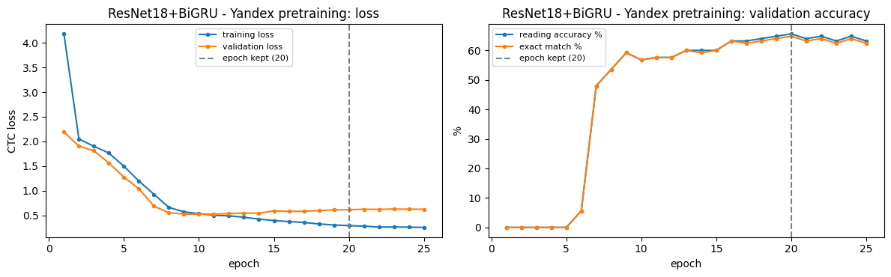
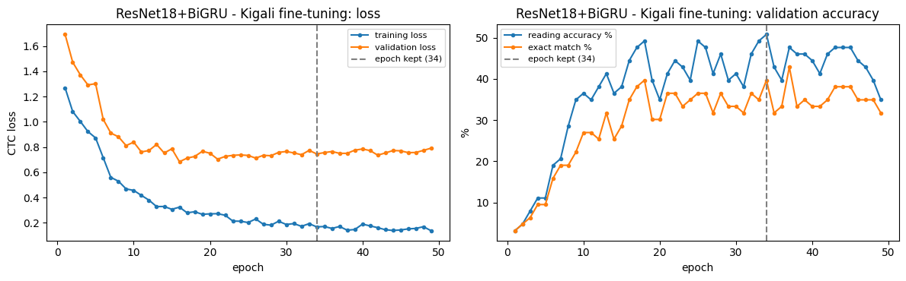
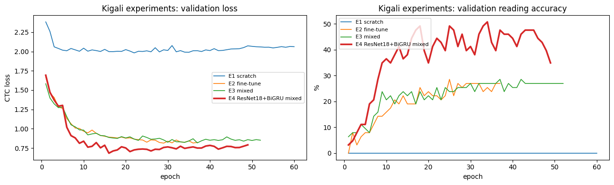
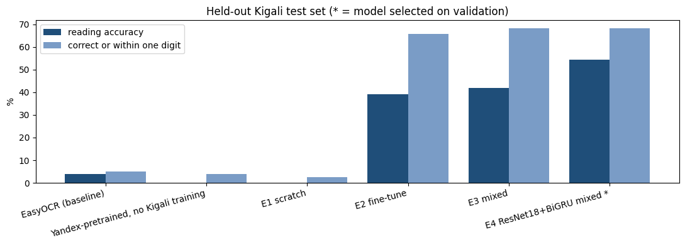
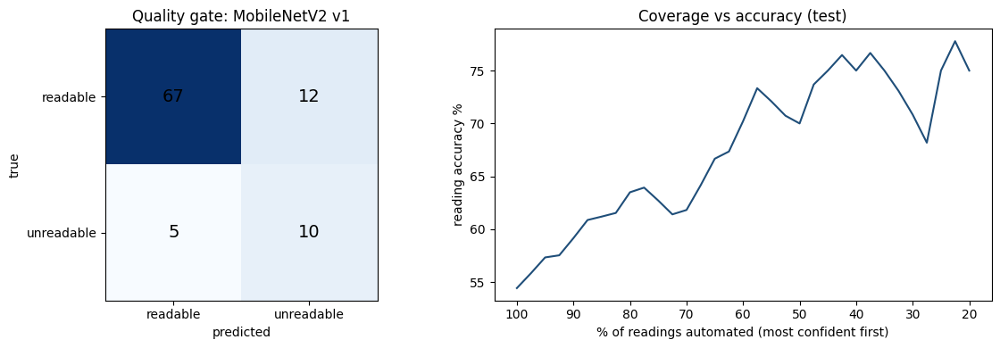

# Saved meter-reading experiment: 2 November 2026

Imported on 15 November 2026 from Paulette's executed Kaggle notebook. This is a historical
rerun, not a new training or evaluation performed during import. The original file is preserved
outside the code repository in the full-report reference workspace. [manifest.json](manifest.json)
records source hashes, execution timestamps and import limits.

## Evidence available

- [Executed notebook](../../../../notebooks/evidence/meter_reading_executed_2026-11-02.ipynb): saved code, text outputs and aggregate charts. Four photo-bearing displays are omitted from this repository copy; the original is preserved separately. Zero-based cell indices are unchanged.
- [Validation candidates](validation_candidates_from_notebook.csv), transcribed programmatically from cell 66's printed table.
- [Test results](test_results_from_notebook.csv), transcribed programmatically from cell 68's printed table.
- [Saved text outputs](outputs/): one file per original cell with textual output, including epoch logs. Printed precision is retained.
- [Plots](plots/): ten PNG displays decoded directly from notebook outputs. These are embedded display images, which may differ in resolution from Kaggle's `savefig` exports.

The supplied `results(1).zip` was **0 bytes** and was not a valid ZIP. Its original result CSVs,
per-photo predictions, full-precision training histories and split inventories were not recovered.
The two aggregate CSVs here are explicitly derived from displayed tables, not extracted from that ZIP.
The notebook says it created `mubazi_notebook_evidence.zip`; that archive was not supplied.

## Separate this rerun from the deployed model

| Measure | Deployed configuration | This notebook rerun |
|---|---:|---:|
| Selected architecture | E4 ResNet18 + BiGRU mixed | E4 ResNet18 + BiGRU mixed |
| Normalized-reading accuracy | 55.7% | 54.43% |
| Mean per-group reading accuracy | 55.74% | 51.67% |
| Correct or within one digit | 70.89% | 68.35% |
| Meter-cluster bootstrap 95% interval | 42–69% | 40–68% |
| Strict string exact match | Not recorded in deployed config | 39.24% |
| Test photos / inferred groups | 79 / 34 | 79 / 34 |

The deployed column is from [model_config.json](../../../../backend/ml/model_config.json), dated
12 October 2026. The rerun is from saved cell 68. No deployed weights, thresholds or runtime code
were changed. Same architecture and split counts do not establish identical weights or per-photo
predictions. These curves illustrate the rerun, not the exact training trajectory of the deployed model.
Training variability is a possible explanation for the difference; this import does not establish its cause.
This is a rerun of the development evaluation, not an additional independent held-out study.

## Data and splitting observed in the outputs

The notebook reports 652 Kigali photos, 536 readable labels, 98 unreadable crops and 1,244 Yandex
photos. Readable verification statuses are 312 corrected, 205 correct and 19 partial. It reports
586 window crops, 55 digit-box crops, 10 full-photo fallbacks and one undecodable photo (cell 13).

| Set | Readable Kigali photos | Inferred meter groups |
|---|---:|---:|
| Training before cap | 394 | 158 |
| Training after maximum four photos per group | 310 | 158 |
| Validation | 63 | 34 |
| Test | 79 | 34 |

The 84 photos removed by the training cap explain why 310 + 63 + 79 is less than 536. Yandex
splits are 1,119 training / 125 validation; unreadable splits are 68 / 15 / 15. Seed is 42.
Partial labels remain: 10 training, 3 validation and 6 test (cell 33).

Groups are **inferred from readings**, using union-find on equal normalized readings or a shared
prefix after removing the last two digits for strings of at least five digits. Assertions show no
inferred group or grouping key crosses splits. These are not verified physical meter identities;
the heuristic can merge unrelated meters or miss related photos. It does not establish complete
photo-duplicate prevention. The raw split CSVs remain unavailable.

Cell 54 chooses a leading-zero repair method using hand-typed labels across the full readable
inventory, and changes 254 labels using the Yandex-pretrained reader. That includes preprocessing
of the test labels; strict string accuracy therefore uses partly model-assisted references. The
normalized metric removes leading zeros, but this procedure and the heuristic grouping still limit
claims about a completely untouched, independently annotated test set.

## Validation comparison and selection

Values below are printed outputs from cell 66 on 63 photos / 34 inferred groups.

| Candidate | Parameters | Strict exact % | Reading % | Per-group reading % | Edit distance |
|---|---:|---:|---:|---:|---:|
| E1 CRNN scratch | 4,186,059 | 0.00 | 0.00 | 0.00 | 4.59 |
| E2 CRNN fine-tune | 4,186,059 | 19.05 | 28.57 | 29.53 | 1.40 |
| E3 CRNN mixed | 4,186,059 | 23.81 | 28.57 | 30.27 | 1.32 |
| E4 ResNet18 + BiGRU mixed | 4,760,651 | 39.68 | 50.79 | 47.28 | 0.84 |

The notebook selects by validation mean per-group reading accuracy. Candidates within three
percentage points of the best are tied, then fewer parameters and higher reading accuracy decide.
E4 is selected before the test cell. Within each Kigali training run, checkpoint selection instead
uses photo-level validation reading accuracy, with edit distance breaking ties. Distinguish these
two selection steps. EasyOCR's saved validation reading accuracy is 1.59%; its test result is 3.80%.
Cell 39's earlier inline baseline summary says exact 1.6%, whereas cells 59 and 68 print strict exact
0.00%; use the comparison tables for strict exact values and retain this inconsistency in the source.

## Learning curves

E4 pretraining on Yandex, this rerun (cell 83). The retained checkpoint is epoch 20 of 25,
selected by validation strict exact match. The accompanying output reports validation reading
accuracy 65.6% and validation CTC loss 0.617.

E4 mixed-data fine-tuning, evaluated on Kigali validation (cell 83). The retained checkpoint
is epoch 34 of 49: validation reading accuracy 50.79%, strict exact match 39.68% and validation
CTC loss approximately 0.746. Training stops after 15 epochs without a better selection score.
Training loss continues to decrease while validation loss levels off and accuracy fluctuates;
this is consistent with overfitting and limited generalization. The minimum validation loss and
the retained checkpoint need not coincide because selection uses reading accuracy.

E1–E4 validation loss and reading accuracy, this rerun (cell 83). These are validation curves;
they do not measure test-set learning or prove the deployed run's training behavior.

## Test outputs and quality gate

In this rerun E4 gives 54.43% normalized-reading accuracy (43/79), 39.24% strict string exact
match (31/79), mean normalized edit distance 0.75 and 68.35% correct or within one digit (54/79).
“Within one digit” means equality or one differing character in equal-length normalized strings;
it is not numeric ±1 m³ or individual-digit accuracy. The displayed 40–68% interval uses whole-group
bootstrap resampling (cell 6), and depends on the inferred grouping.

MobileNetV2 v1 is selected by validation AUC (0.746), with printed threshold 0.428. On this rerun's
79 readable and 15 unreadable test photos it flags 12 readable photos (15.19%), catches 10 unreadable
photos (66.67%), and misses 5. Unreadable is the positive class: precision 45.455%, recall 66.667%,
F1 54.054%, AUC 0.851 (cell 76). These are the notebook's gate-only results, distinct from the
application's combined advisory-guidance evaluation in [guidance calibration](../../../calibration/guidance_calibration.md).
The gate remains advisory. This evidence does not support autonomous billing or achievement of the
proposal's readable false-warning / unreadable-detection targets.

## Placement

Use the split and selection tables in the full research report's methodology; use the three learning
curves and rerun test results in its results/discussion; use the source notebook, logs and provenance
in its reproducibility appendix. Keep the five-page product technical report concise and link here.
Application test counts, the synthetic anomaly experiment and participant evaluation remain separate.
